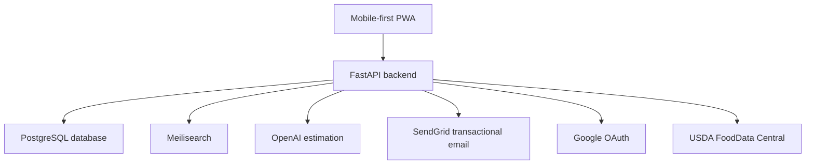
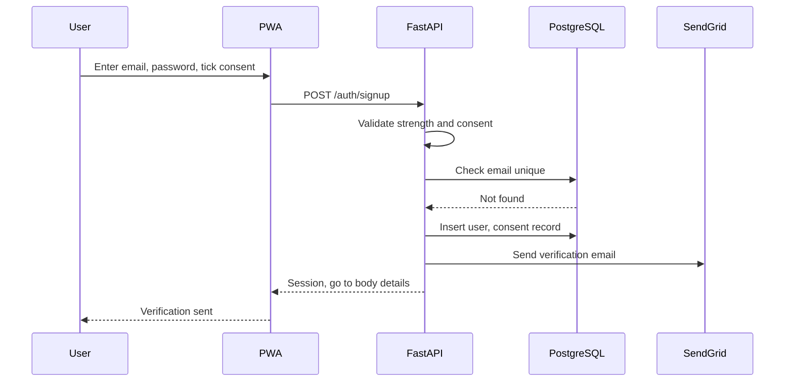
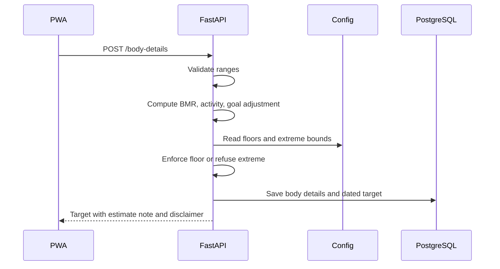
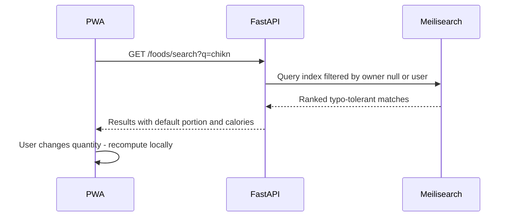
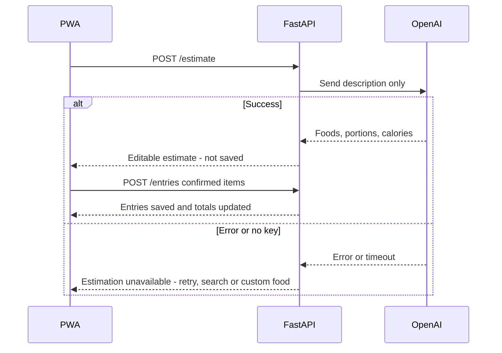
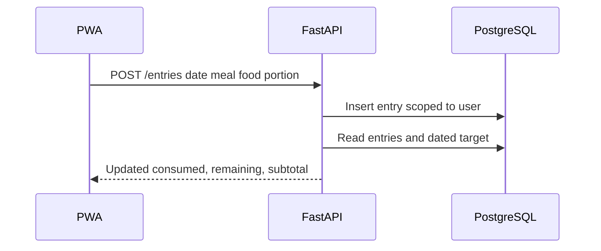
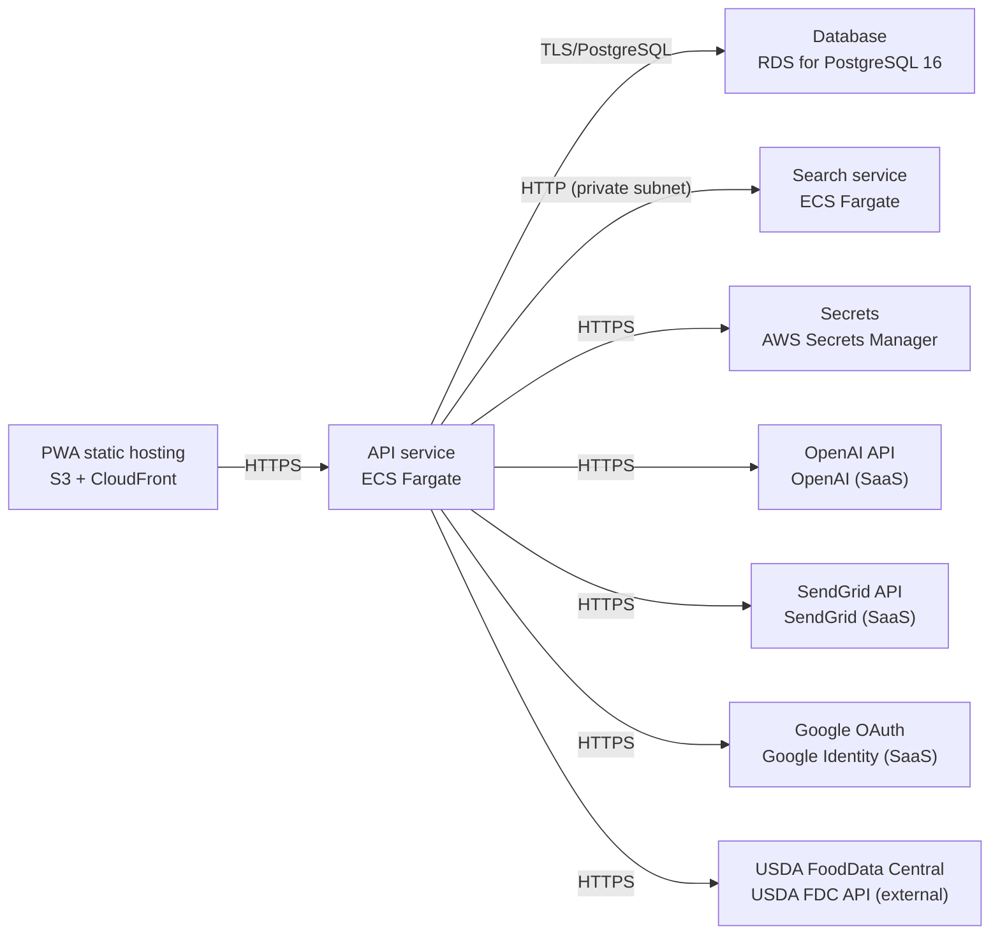

# Architecture

> Maintained by QuorQ AI SDLC. Text between `sdlc:auto` markers is regenerated; anything outside them is yours and is kept.

<!-- sdlc:auto:start narrative -->
## Overview

### ARCH-000 · draft

No architecture phase input has been provided for this project.

No design documents, data models, API contracts, screen inventories, infrastructure topology, or technology-usage decisions beyond the product-owner-approved stack (FastAPI, AWS, PostgreSQL 16, React 19) and approved services (OpenAI, Meilisearch, SendGrid, Google OAuth, USDA FDC) have been recorded.

- ⚠ Architecture phase has not started - no design artifacts, diagrams, data model, or screen definitions exist yet to document.
<!-- sdlc:auto:end narrative -->

<!-- sdlc:auto:start building-blocks -->
## Building Block View

| ID | Name | Technology | Responsibility | Depends on |
|---|---|---|---|---|
| web | Mobile-first PWA | React 19 | React single-page app installable to the phone home screen: signup/sign-in, consent, body details, today's log grouped by meal, add/search/estimate flows, history, settings, export and delete. Renders calorie figures only, shows the disclaimer, handles instant client-side total recalculation. | api |
| api | FastAPI backend | FastAPI 0.115 | Single auditable server for auth and sessions, consent capture, the calorie engine (Mifflin-St Jeor, activity multiplier, deficit/surplus, configurable floors and extreme-target refusal), food log CRUD with per-date targets, custom foods, catalogue seed/sync, search orchestration, OpenAI estimation with graceful fallback, and GDPR export/delete. Enforces that every request returns only the signed-in user's data. | db, search, ai, email, oauth, usda |
| db | PostgreSQL database | PostgreSQL 16 | Durable store for accounts, consent records, body details, dated calorie targets, foods, portions and food entries. Placed with backups in an AWS EU region for GDPR. Cascading delete removes a user's personal data while the shared seeded catalogue is retained. | — |
| search | Meilisearch | Meilisearch v1.10.3 (getmeili/meilisearch:v1.10.3) | Typo-tolerant, partial-name food search from two characters across the USDA seed and a user's own custom foods, ranking closest and most commonly logged matches first. Indexed from the foods table. | — |
| ai | OpenAI estimation | OpenAI (SaaS) | Turns a typed meal description ('two eggs and toast with butter') into an editable breakdown of foods, portions and calories. Only the user's description is sent, never another user's data. | — |
| email | SendGrid transactional email | SendGrid (SaaS) | Delivers email-verification and password-reset messages worldwide without running a mail server. | — |
| oauth | Google OAuth | Google OAuth (custom) | One-tap Google sign-in alongside email/password; returns an identity matched to or creating an account by Google email. | — |
| usda | USDA FoodData Central | USDA FoodData Central (custom) | Authoritative source that seeds the food catalogue with common foods, calorie values and portion definitions, with required attribution; thin on branded products (accepted). | — |

<!-- sdlc:auto:end building-blocks -->

<!-- sdlc:auto:start runtime -->
## Runtime View

### Email signup with consent and verification

New visitor submits email, password and the ticked consent box; the backend validates strength and uniqueness, hashes the password, records the consent wording version and timestamp, issues a session, sends a single-use verification email, and routes to body details. Nothing is stored without consent.

- **Components:** web, api, db, email
- **Modules:** auth/signup, auth/password, consent, email/verification
- **Key functions:** validate_signup(email, password, consent), hash_password(password), create_user_with_consent(email, hash, consent_version), issue_verification_token(user_id), send_verification_email(user, token)

### Calorie target calculation with floor and refusal

On saving valid body details the server computes BMR by Mifflin-St Jeor for the user's sex, applies the activity multiplier, derives a deficit or surplus from current-vs-target weight, raises results below the configured sex floor, and refuses extreme inputs with a kind message. The dated target is persisted so past days keep their figure.

- **Components:** web, api, db
- **Modules:** calorie_engine/mifflin, calorie_engine/floors, calorie_engine/validation, targets/history
- **Key functions:** mifflin_st_jeor(sex, weight, height, age), apply_activity(bmr, level), apply_goal_adjustment(maintenance, current_kg, target_kg), enforce_floor_and_bounds(value, sex, config), persist_dated_target(user_id, value, source, effective_date)

### Food search and portion pick

From two characters the backend queries Meilisearch scoped to the seed plus the user's custom foods, returns typo-tolerant ranked matches each with a default portion and calories; selecting a portion/quantity recalculates calories instantly before saving.

- **Components:** web, api, search, db
- **Modules:** search/query, foods/portions, entries/calc
- **Key functions:** search_foods(term, user_id), get_portions(food_id), calc_calories(portion, quantity)

### Plain-English estimation with fallback

User types a meal description; the backend sends only that text to OpenAI, returns an editable breakdown labelled an estimate, and saves nothing until confirmed. On error, timeout or missing key the user gets a calm message with retry, search or custom-food options and no partial entry is written.

- **Components:** web, api, ai, db
- **Modules:** estimation/parse, estimation/fallback, entries/create
- **Key functions:** estimate_meal(description, user_id), handle_estimation_error(e), save_confirmed_items(user_id, date, meal, lines)

### Add entry and day totals

Adding, editing or deleting an entry on a chosen meal and date saves against that date only, then the day's consumed, remaining and meal subtotals update immediately; past-date edits never affect today and each day shows the target that applied then.

- **Components:** web, api, db
- **Modules:** entries/crud, log/totals, targets/for_date
- **Key functions:** add_entry(user_id, date, meal, food, portion, qty), recalc_day_totals(user_id, date), target_for_date(user_id, date)

<!-- sdlc:auto:end runtime -->

<!-- sdlc:auto:start deployment-view -->
## Deployment View

| Name | Service | Runtime | Scaling | Environment |
|---|---|---|---|---|
| PWA static hosting | S3 + CloudFront | React 19 static build | CDN edge, static | dev |
| API service | ECS Fargate | FastAPI 0.115 on Uvicorn (Python 3.12) | 1-2 small tasks | dev |
| Database | RDS for PostgreSQL 16 | PostgreSQL 16 | Single managed instance with automated backups, EU region | dev |
| Search service | ECS Fargate | getmeili/meilisearch:v1.10.3 | 1 task with persistent EFS volume | dev |
| Secrets | AWS Secrets Manager | managed | n/a | dev |
| OpenAI API | OpenAI (SaaS) | external HTTPS | external | dev |
| SendGrid API | SendGrid (SaaS) | external HTTPS | external | dev |
| Google OAuth | Google Identity (SaaS) | external HTTPS | external | dev |
| USDA FoodData Central | USDA FDC API (external) | external HTTPS | external, used by seed job | dev |

| Source | Target | Protocol |
|---|---|---|
| PWA static hosting | API service | HTTPS |
| API service | Database | TLS/PostgreSQL |
| API service | Search service | HTTP (private subnet) |
| API service | Secrets | HTTPS |
| API service | OpenAI API | HTTPS |
| API service | SendGrid API | HTTPS |
| API service | Google OAuth | HTTPS |
| API service | USDA FoodData Central | HTTPS |

<!-- sdlc:auto:end deployment-view -->

<!-- sdlc:auto:start decisions -->
## Architecture Decisions

| Layer | Choice | ADR |
|---|---|---|
| Frontend | React 19 | [ADR-0001](adr/frontend.md) |
| Backend | FastAPI 0.115 | [ADR-0002](adr/backend.md) |
| Database | PostgreSQL 16 | [ADR-0003](adr/database.md) |
| Cloud | AWS | [ADR-0004](adr/cloud.md) |
<!-- sdlc:auto:end decisions -->

<!-- sdlc:auto:start links -->
## Related Documents

- [Data Model](data-model.md)
- [API Specification](api/openapi.yaml)
- [Architecture Decision Records](adr/README.md)
<!-- sdlc:auto:end links -->
