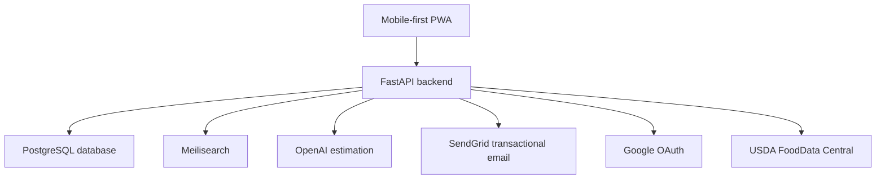
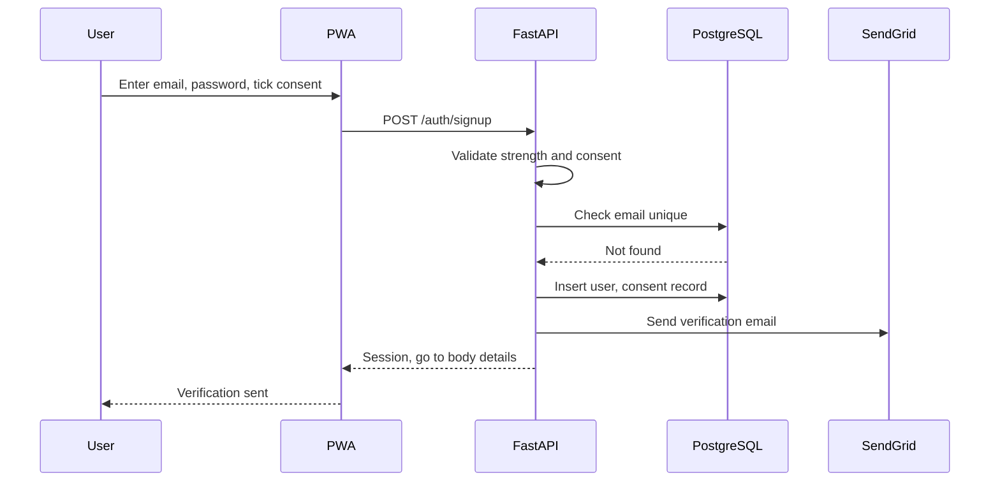
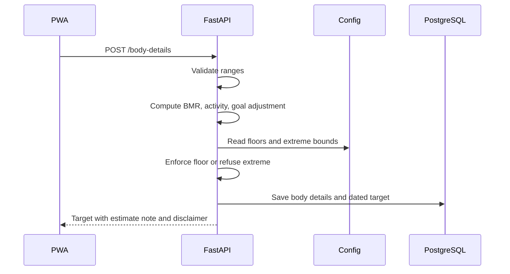
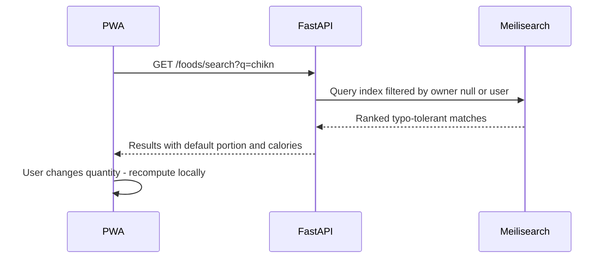
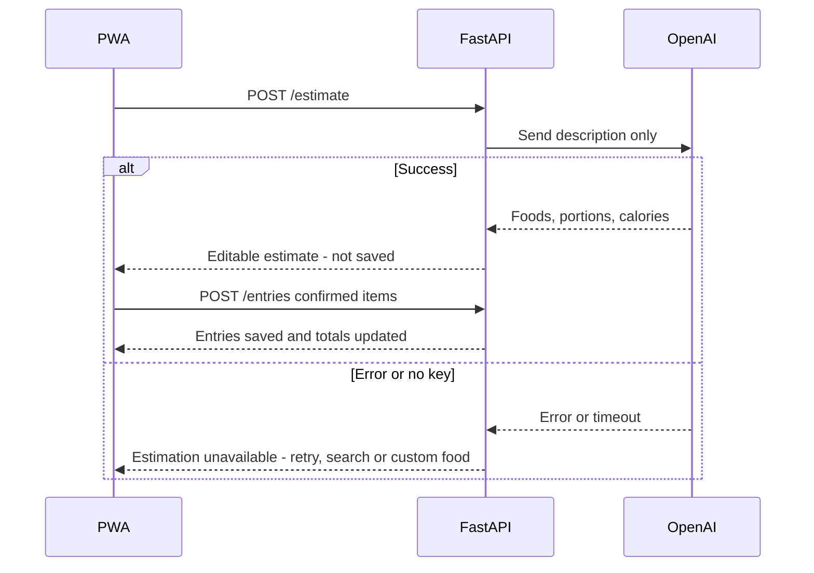
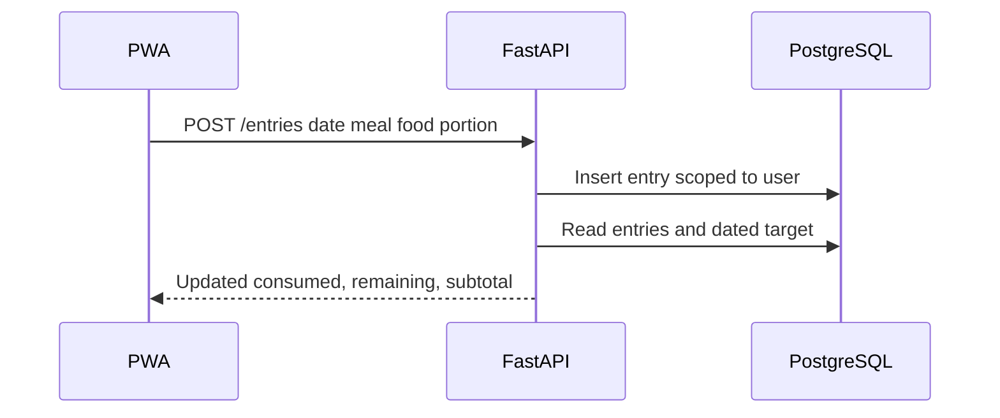
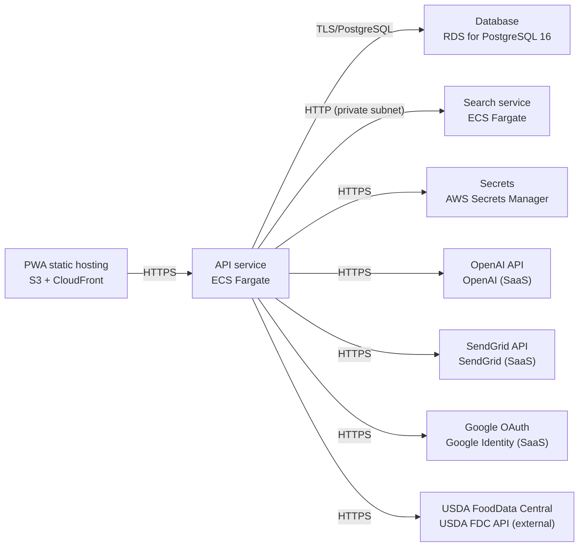

# Architecture

> Maintained by QuorQ AI SDLC. Text between `sdlc:auto` markers is regenerated; anything outside them is yours and is kept.

<!-- sdlc:auto:start narrative -->
## Overview

### ARCH-001-OVERVIEW · approved · source: architecture

Mobile-first, installable PWA (React 19) backed by a single FastAPI 0.115 server that owns all auditable logic (auth, calorie engine, food log, search orchestration, AI estimation, GDPR export/delete). PostgreSQL 16 in an AWS EU region is the system of record. Product is free, positioned as general wellness with a visible 'not medical advice' disclaimer.

Architecture version 1, status approved. The backend is the sole owner of: email/password and Google sign-in; the Mifflin-St Jeor BMR calculation with activity multiplier; target-weight-driven deficit/surplus; configurable ~1200/1500 kcal sex floors and extreme-target refusal; the daily food log grouped by meal; custom foods; USDA-seeded catalogue search via Meilisearch; and plain-English meal estimation via OpenAI. PostgreSQL 16 stores all tabular/related data (accounts, consent, body details, dated calorie targets, foods, portions, food entries) and is deliberately placed with backups in an AWS EU region so self-service export is one query and deletion is one cascading delete. SendGrid sends verification/reset email; Google OAuth provides one-tap sign-in; USDA FoodData Central seeds the catalogue. No billing/monetization logic exists in this architecture.

**Related:** ARCH-COMP-WEB, ARCH-COMP-API, ARCH-COMP-DB, ARCH-COMP-SEARCH, ARCH-COMP-AI, ARCH-COMP-EMAIL, ARCH-COMP-OAUTH, ARCH-COMP-USDA

- ⚠ No formal requirements or NFR catalog was supplied alongside this architecture -- only ad hoc citations (NFR-007, NFR-015, NFR-018, NFR-024, NFR-025, US-030) appear inside the technology-decision rationale, so full traceability against all known requirement keys US-001..US-031 cannot be confirmed from this input alone.
- ⚠ No industry/compliance domain skill was named for this project; the GDPR-style handling (EU region, export/delete) is a design choice stated in the input, not a verified regulatory mapping -- treat as general good practice, not confirmed legal compliance.

### ARCH-COMP-WEB · approved · source: architecture:components.web

Mobile-first React 19 single-page app, installable to the phone home screen as a PWA, covering the full end-user flow from signup through settings/export/delete.

Covers: signup/sign-in, consent, body details, today's log grouped by meal, add/search/estimate flows, history, settings, export and delete. Renders calorie figures only (no server-side rendering of totals), shows the 'not medical advice' disclaimer, and performs instant client-side recalculation of totals when portions/estimates change.

**Related:** ARCH-COMP-API, US-030

### ARCH-COMP-API · approved · source: architecture:components.api

Single FastAPI 0.115 backend is the one auditable server for auth/sessions, the calorie engine, food log CRUD, catalogue seed/sync, search orchestration, OpenAI estimation with fallback, and GDPR export/delete.

Responsibilities: auth and sessions; consent capture; calorie engine (Mifflin-St Jeor, activity multiplier, deficit/surplus, configurable floors, extreme-target refusal); food log CRUD with per-date targets; custom foods; catalogue seed/sync from USDA; search orchestration against Meilisearch; OpenAI estimation calls with graceful fallback; GDPR export/delete. Enforces that every request returns only the signed-in user's own data.

**Related:** ARCH-COMP-WEB, ARCH-COMP-DB, ARCH-COMP-SEARCH, ARCH-COMP-AI, ARCH-COMP-EMAIL, ARCH-COMP-OAUTH

### ARCH-COMP-DB · approved · source: architecture:components.db

PostgreSQL 16 is the durable store for accounts, consent, body details, dated calorie targets, foods, portions and food entries, run with backups in an AWS EU region.

Cascading delete removes a user's personal data on account deletion while the shared seeded food catalogue is retained. EU-region placement with backups is explicitly for GDPR-style handling.

**Related:** ARCH-COMP-API, ARCH-DATA-MODEL, ARCH-TECH-DB

### ARCH-COMP-SEARCH · approved · source: architecture:components.search

Meilisearch v1.10.3 provides typo-tolerant, partial-name food search from two characters across the USDA seed and the user's own custom foods.

Ranks closest and most commonly logged matches first. Indexed from the `foods` table.

**Related:** ARCH-COMP-API, ARCH-CP-SEARCH

### ARCH-COMP-AI · approved · source: architecture:components.ai

OpenAI (SaaS) turns a typed meal description into an editable breakdown of foods, portions and calories.

Only the user's own description text is sent to OpenAI -- never another user's data. Output is presented as an editable, unsaved estimate.

**Related:** ARCH-COMP-API, ARCH-CP-ESTIMATE

### ARCH-COMP-EMAIL · approved · source: architecture:components.email

SendGrid delivers email-verification and password-reset messages worldwide without the project running its own mail server.

Transactional-only usage: verification email on signup, reset email on forgot-password flow.

**Related:** ARCH-COMP-API, ARCH-CP-SIGNUP

### ARCH-COMP-OAUTH · approved · source: architecture:components.oauth

Google OAuth provides one-tap sign-in alongside email/password.

Returns an identity matched to or creating an account by Google email address.

**Related:** ARCH-COMP-API, ARCH-CP-SIGNUP

### ARCH-COMP-USDA · approved · source: architecture:components.usda

USDA FoodData Central is the authoritative source seeding the food catalogue with common foods, calorie values and portion definitions.

Requires attribution where used. Explicitly accepted as thin on branded products.

**Related:** ARCH-COMP-SEARCH, ARCH-DATA-MODEL

### ARCH-CP-SIGNUP · approved · source: architecture:critical_paths.email_signup

Email signup requires consent at the point of submission; nothing is stored until the consent box is ticked.

New visitor submits email, password and the ticked consent box. Backend validates password strength and email uniqueness, hashes the password, records the consent wording version and timestamp, issues a session, sends a single-use verification email, and routes to body details. Nothing is stored without consent.

**Related:** ARCH-COMP-API, ARCH-COMP-EMAIL, ARCH-COMP-WEB, ARCH-DATA-MODEL

### ARCH-CP-TARGET · approved · source: architecture:critical_paths.target_calculation

Calorie target calculation applies Mifflin-St Jeor plus activity multiplier and target-weight deficit/surplus, with a configured sex floor and refusal for extreme inputs.

On saving valid body details the server computes BMR by Mifflin-St Jeor for the user's sex, applies the activity multiplier, derives a deficit or surplus from current-vs-target weight, raises results below the configured sex floor, and refuses extreme inputs with a kind message. The dated target is persisted so past days keep the figure that applied at the time.

**Related:** ARCH-COMP-API, ARCH-DATA-MODEL

### ARCH-CP-SEARCH · approved · source: architecture:critical_paths.food_search

Food search and portion pick returns typo-tolerant ranked matches from two characters, each with a default portion and calories; selecting recalculates instantly.

Backend queries Meilisearch scoped to the seed catalogue plus the user's own custom foods. Selecting a portion/quantity recalculates calories instantly client-side before saving.

**Related:** ARCH-COMP-API, ARCH-COMP-SEARCH, ARCH-DATA-MODEL

### ARCH-CP-ESTIMATE · approved · source: architecture:critical_paths.plain_english_estimation

Plain-English meal estimation sends only the user's typed description to OpenAI and returns an editable, unsaved breakdown, with a graceful fallback on failure.

User types a meal description; backend sends only that text to OpenAI and returns an editable breakdown labelled an estimate; nothing is saved until confirmed. On error, timeout, or missing key the user gets a calm message with retry, search, or custom-food options, and no partial entry is written.

**Related:** ARCH-COMP-API, ARCH-COMP-AI

### ARCH-CP-ENTRIES · approved · source: architecture:critical_paths.add_entry_totals

Adding, editing or deleting a food entry on a chosen meal and date updates that day's consumed, remaining, and meal subtotals immediately.

Entries save against the specified date only. Past-date edits never affect today, and each day shows the target that applied at that time.

**Related:** ARCH-COMP-API, ARCH-DATA-MODEL

### ARCH-DATA-MODEL · approved · source: architecture:entities

Eight relational entities back the system: users, body_details, calorie_targets, foods, food_portions, food_entries, email_tokens, sessions.

users(id, email, password_hash, email_verified, google_sub, consent_version, consent_given_at, created_at); body_details(id, user_id, height_cm, weight_kg, age, sex, activity_level, target_weight_kg, unit_preference, updated_at); calorie_targets(id, user_id, value_kcal, source, calculated_value_kcal, floored, effective_date, created_at); foods(id, source, owner_user_id, name, fdc_id, attribution, created_at); food_portions(id, food_id, label, grams, calories, is_default); food_entries(id, user_id, log_date, meal, food_id, food_name_snapshot, portion_label, quantity, calories, created_at); email_tokens(id, user_id, token_hash, type, expires_at, used_at); sessions(id, user_id, token_hash, expires_at, revoked_at).

**Related:** ARCH-COMP-DB, ARCH-COMP-API

- ⚠ No explicit foreign-key/index/constraint details were given beyond field names -- schema-level constraints are implied, not documented.

### ARCH-API-SURFACE · approved · source: architecture:endpoints

Full REST surface of the FastAPI backend: auth/session, consent, body details/target, daily log/history/entries, food search/custom foods, AI estimation, and privacy export/delete.

Auth/session: POST /auth/signup (email/password + required consent, starts session, triggers verification email); POST /auth/login (generic failure message); POST /auth/logout; GET /auth/google/start; GET /auth/google/callback (create/match by email, prompts consent for first-time users, no account on deny); POST /auth/verify-email; POST /auth/forgot-password (identical response whether or not address exists); POST /auth/reset-password (invalidates all sessions). Consent: POST /consent (records wording version + timestamp for Google first-time users before data storage). Body details/target: POST /body-details (save + compute/persist dated target); PUT /body-details (recalculate subject to floor, preserve manual target with a prompt); GET /target (source calculated|manual, whether floored); PUT /target (set manual override, refused below floor/extreme, or revert to calculated). Log/history/entries: GET /log (day grouped by meal with subtotals, consumed, target, remaining); GET /history (recent days: date, consumed, applied target, under/over; empty days shown as no entries); POST /entries (add, returns updated totals); PUT /entries/{id} (edit portion/calories/meal, move section, recalc, own entries only); DELETE /entries/{id} (delete own entry after confirmation, recalc); GET /entries/recent (recently logged foods/portions for one-tap re-log). Foods: GET /foods/search (typo-tolerant from two characters, seed + own custom, ranked, default portion/calories); GET /foods/{id} (detail with portions and USDA attribution where applicable); POST /foods/custom (create private custom food, validated); PUT /foods/custom/{id} (edit own, past entries keep recorded figures); DELETE /foods/custom/{id} (delete own, logged entries stay intact). AI: POST /estimate (send only user's description to OpenAI, return editable unsaved breakdown or calm unavailable message). Privacy: GET /privacy/consent (consent date, wording version, export/delete links); POST /account/export (machine-readable export of all own data); DELETE /account (self-service delete after explicit confirmation, cascading removal, sessions ended, seeded catalogue retained).

**Related:** ARCH-COMP-API, ARCH-CP-SIGNUP, ARCH-CP-TARGET, ARCH-CP-SEARCH, ARCH-CP-ESTIMATE, ARCH-CP-ENTRIES

- ⚠ Endpoints are not individually mapped to specific requirement ids (US-001..US-031) in the input -- only the technology-decision section names specific ids (US-030 and NFR-007/015/018/024/025).

### ARCH-DEPLOYMENT · approved · source: architecture:deployment_nodes

All-AWS deployment: static PWA on S3+CloudFront, API and search as ECS Fargate services, PostgreSQL on RDS, secrets in Secrets Manager, plus three external SaaS integrations.

Nodes: PWA static hosting (S3 + CloudFront, React 19 static build); API service (ECS Fargate, FastAPI 0.115 on Uvicorn / Python 3.12); Database (RDS for PostgreSQL 16); Search service (ECS Fargate, getmeili/meilisearch:v1.10.3); Secrets (AWS Secrets Manager, managed); OpenAI API (external HTTPS); SendGrid API (external HTTPS); Google OAuth (Google Identity SaaS, external HTTPS); USDA FoodData Central (external HTTPS API).

**Related:** ARCH-COMP-WEB, ARCH-COMP-API, ARCH-COMP-DB, ARCH-COMP-SEARCH, ARCH-TECH-CLOUD

- ⚠ No networking/VPC topology, scaling policy, or monitoring/alerting setup was specified for the Fargate services or RDS instance.

### ARCH-TECH-FRONTEND · approved · source: architecture:technology_decisions.frontend

React 19 chosen over Vue/SvelteKit to build the mobile-first SPA with instant client-side recalculation and installable PWA behavior.

Rationale: builds the mobile-first SPA with instant client-side recalculation of totals and portion/estimate figures (NFR-018), and ships as an installable PWA with a web manifest and service worker so it saves to the home screen in a standalone window (US-030, NFR-024). Alternatives considered: Vue, SvelteKit.

**Related:** US-030, NFR-018, NFR-024, ARCH-COMP-WEB

### ARCH-TECH-BACKEND · approved · source: architecture:technology_decisions.backend

FastAPI 0.115 chosen over Django REST Framework/Flask to hold the entire calorie engine in one auditable server.

Rationale: holds the whole calorie engine -- Mifflin-St Jeor, activity multiplier, deficit/surplus, configurable floors and extreme-target refusal -- in one auditable server (NFR-015), and sits cleanly in front of the OpenAI estimation call and the USDA seed import. Alternatives considered: Django REST Framework, Flask.

**Related:** NFR-015, ARCH-COMP-API

### ARCH-TECH-DB · approved · source: architecture:technology_decisions.database

PostgreSQL 16 chosen over MySQL/SQLite because the data is tabular and related, and an EU-region deployment satisfies GDPR-style export/delete needs.

Rationale: accounts, consent, body details, dated targets, foods, portions and entries are tabular and related; GDPR export is one query and deletion is one cascading delete, and placing the instance plus backups in an EU region satisfies NFR-007. Alternatives considered: MySQL, SQLite.

**Related:** NFR-007, ARCH-COMP-DB

### ARCH-TECH-CLOUD · approved · source: architecture:technology_decisions.cloud

AWS chosen over GCP/Azure for managed RDS in an EU region, Fargate for API/search without server patching, and headroom for a worldwide low-thousands audience.

Rationale: managed RDS Postgres in an EU region with backups meets the GDPR commitment, Fargate runs the API and the Meilisearch container without patching servers, and the platform grows without re-platforming for a worldwide low-thousands audience (NFR-025). Alternatives considered: GCP, Azure.

**Related:** NFR-025, ARCH-DEPLOYMENT
<!-- sdlc:auto:end narrative -->

<!-- sdlc:auto:start building-blocks -->
## Building Block View

| ID | Name | Technology | Responsibility | Depends on |
|---|---|---|---|---|
| web | Mobile-first PWA | React 19 | React single-page app installable to the phone home screen: signup/sign-in, consent, body details, today's log grouped by meal, add/search/estimate flows, history, settings, export and delete. Renders calorie figures only, shows the disclaimer, handles instant client-side total recalculation. | api |
| api | FastAPI backend | FastAPI 0.115 | Single auditable server for auth and sessions, consent capture, the calorie engine (Mifflin-St Jeor, activity multiplier, deficit/surplus, configurable floors and extreme-target refusal), food log CRUD with per-date targets, custom foods, catalogue seed/sync, search orchestration, OpenAI estimation with graceful fallback, and GDPR export/delete. Enforces that every request returns only the signed-in user's data. | db, search, ai, email, oauth, usda |
| db | PostgreSQL database | PostgreSQL 16 | Durable store for accounts, consent records, body details, dated calorie targets, foods, portions and food entries. Placed with backups in an AWS EU region for GDPR. Cascading delete removes a user's personal data while the shared seeded catalogue is retained. | — |
| search | Meilisearch | Meilisearch v1.10.3 (getmeili/meilisearch:v1.10.3) | Typo-tolerant, partial-name food search from two characters across the USDA seed and a user's own custom foods, ranking closest and most commonly logged matches first. Indexed from the foods table. | — |
| ai | OpenAI estimation | OpenAI (SaaS) | Turns a typed meal description ('two eggs and toast with butter') into an editable breakdown of foods, portions and calories. Only the user's description is sent, never another user's data. | — |
| email | SendGrid transactional email | SendGrid (SaaS) | Delivers email-verification and password-reset messages worldwide without running a mail server. | — |
| oauth | Google OAuth | Google OAuth (custom) | One-tap Google sign-in alongside email/password; returns an identity matched to or creating an account by Google email. | — |
| usda | USDA FoodData Central | USDA FoodData Central (custom) | Authoritative source that seeds the food catalogue with common foods, calorie values and portion definitions, with required attribution; thin on branded products (accepted). | — |

<!-- sdlc:auto:end building-blocks -->

<!-- sdlc:auto:start runtime -->
## Runtime View

### Email signup with consent and verification

New visitor submits email, password and the ticked consent box; the backend validates strength and uniqueness, hashes the password, records the consent wording version and timestamp, issues a session, sends a single-use verification email, and routes to body details. Nothing is stored without consent.

- **Components:** web, api, db, email
- **Modules:** auth/signup, auth/password, consent, email/verification
- **Key functions:** validate_signup(email, password, consent), hash_password(password), create_user_with_consent(email, hash, consent_version), issue_verification_token(user_id), send_verification_email(user, token)

### Calorie target calculation with floor and refusal

On saving valid body details the server computes BMR by Mifflin-St Jeor for the user's sex, applies the activity multiplier, derives a deficit or surplus from current-vs-target weight, raises results below the configured sex floor, and refuses extreme inputs with a kind message. The dated target is persisted so past days keep their figure.

- **Components:** web, api, db
- **Modules:** calorie_engine/mifflin, calorie_engine/floors, calorie_engine/validation, targets/history
- **Key functions:** mifflin_st_jeor(sex, weight, height, age), apply_activity(bmr, level), apply_goal_adjustment(maintenance, current_kg, target_kg), enforce_floor_and_bounds(value, sex, config), persist_dated_target(user_id, value, source, effective_date)

### Food search and portion pick

From two characters the backend queries Meilisearch scoped to the seed plus the user's custom foods, returns typo-tolerant ranked matches each with a default portion and calories; selecting a portion/quantity recalculates calories instantly before saving.

- **Components:** web, api, search, db
- **Modules:** search/query, foods/portions, entries/calc
- **Key functions:** search_foods(term, user_id), get_portions(food_id), calc_calories(portion, quantity)

### Plain-English estimation with fallback

User types a meal description; the backend sends only that text to OpenAI, returns an editable breakdown labelled an estimate, and saves nothing until confirmed. On error, timeout or missing key the user gets a calm message with retry, search or custom-food options and no partial entry is written.

- **Components:** web, api, ai, db
- **Modules:** estimation/parse, estimation/fallback, entries/create
- **Key functions:** estimate_meal(description, user_id), handle_estimation_error(e), save_confirmed_items(user_id, date, meal, lines)

### Add entry and day totals

Adding, editing or deleting an entry on a chosen meal and date saves against that date only, then the day's consumed, remaining and meal subtotals update immediately; past-date edits never affect today and each day shows the target that applied then.

- **Components:** web, api, db
- **Modules:** entries/crud, log/totals, targets/for_date
- **Key functions:** add_entry(user_id, date, meal, food, portion, qty), recalc_day_totals(user_id, date), target_for_date(user_id, date)

<!-- sdlc:auto:end runtime -->

<!-- sdlc:auto:start deployment-view -->
## Deployment View

| Name | Service | Runtime | Scaling | Environment |
|---|---|---|---|---|
| PWA static hosting | S3 + CloudFront | React 19 static build | CDN edge, static | dev |
| API service | ECS Fargate | FastAPI 0.115 on Uvicorn (Python 3.12) | 1-2 small tasks | dev |
| Database | RDS for PostgreSQL 16 | PostgreSQL 16 | Single managed instance with automated backups, EU region | dev |
| Search service | ECS Fargate | getmeili/meilisearch:v1.10.3 | 1 task with persistent EFS volume | dev |
| Secrets | AWS Secrets Manager | managed | n/a | dev |
| OpenAI API | OpenAI (SaaS) | external HTTPS | external | dev |
| SendGrid API | SendGrid (SaaS) | external HTTPS | external | dev |
| Google OAuth | Google Identity (SaaS) | external HTTPS | external | dev |
| USDA FoodData Central | USDA FDC API (external) | external HTTPS | external, used by seed job | dev |

| Source | Target | Protocol |
|---|---|---|
| PWA static hosting | API service | HTTPS |
| API service | Database | TLS/PostgreSQL |
| API service | Search service | HTTP (private subnet) |
| API service | Secrets | HTTPS |
| API service | OpenAI API | HTTPS |
| API service | SendGrid API | HTTPS |
| API service | Google OAuth | HTTPS |
| API service | USDA FoodData Central | HTTPS |

<!-- sdlc:auto:end deployment-view -->

<!-- sdlc:auto:start decisions -->
## Architecture Decisions

| Layer | Choice | ADR |
|---|---|---|
| Frontend | React 19 | [ADR-0001](adr/frontend.md) |
| Backend | FastAPI 0.115 | [ADR-0002](adr/backend.md) |
| Database | PostgreSQL 16 | [ADR-0003](adr/database.md) |
| Cloud | AWS | [ADR-0004](adr/cloud.md) |
<!-- sdlc:auto:end decisions -->

<!-- sdlc:auto:start links -->
## Related Documents

- [Data Model](data-model.md)
- [API Specification](api/openapi.yaml)
- [Architecture Decision Records](adr/README.md)
<!-- sdlc:auto:end links -->
