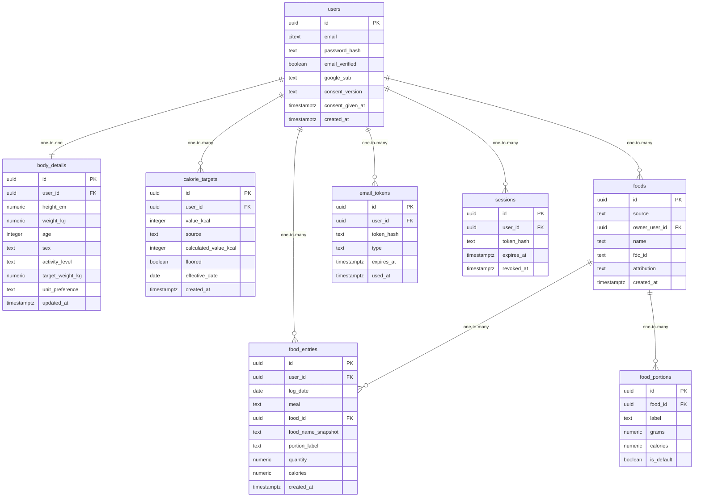

# Data Model

<!-- sdlc:auto:start entities -->
### users

| Field | Type | PK | FK | Nullable |
|---|---|---|---|---|
| id | uuid | True | — | False |
| email | citext | False | — | False |
| password_hash | text | False | — | True |
| email_verified | boolean | False | — | False |
| google_sub | text | False | — | True |
| consent_version | text | False | — | True |
| consent_given_at | timestamptz | False | — | True |
| created_at | timestamptz | False | — | False |

### body_details

| Field | Type | PK | FK | Nullable |
|---|---|---|---|---|
| id | uuid | True | — | False |
| user_id | uuid | False | users.id | False |
| height_cm | numeric | False | — | False |
| weight_kg | numeric | False | — | False |
| age | integer | False | — | False |
| sex | text | False | — | False |
| activity_level | text | False | — | False |
| target_weight_kg | numeric | False | — | False |
| unit_preference | text | False | — | False |
| updated_at | timestamptz | False | — | False |

### calorie_targets

| Field | Type | PK | FK | Nullable |
|---|---|---|---|---|
| id | uuid | True | — | False |
| user_id | uuid | False | users.id | False |
| value_kcal | integer | False | — | False |
| source | text | False | — | False |
| calculated_value_kcal | integer | False | — | True |
| floored | boolean | False | — | False |
| effective_date | date | False | — | False |
| created_at | timestamptz | False | — | False |

### foods

| Field | Type | PK | FK | Nullable |
|---|---|---|---|---|
| id | uuid | True | — | False |
| source | text | False | — | False |
| owner_user_id | uuid | False | users.id | True |
| name | text | False | — | False |
| fdc_id | text | False | — | True |
| attribution | text | False | — | True |
| created_at | timestamptz | False | — | False |

### food_portions

| Field | Type | PK | FK | Nullable |
|---|---|---|---|---|
| id | uuid | True | — | False |
| food_id | uuid | False | foods.id | False |
| label | text | False | — | False |
| grams | numeric | False | — | True |
| calories | numeric | False | — | False |
| is_default | boolean | False | — | False |

### food_entries

| Field | Type | PK | FK | Nullable |
|---|---|---|---|---|
| id | uuid | True | — | False |
| user_id | uuid | False | users.id | False |
| log_date | date | False | — | False |
| meal | text | False | — | False |
| food_id | uuid | False | foods.id | True |
| food_name_snapshot | text | False | — | False |
| portion_label | text | False | — | False |
| quantity | numeric | False | — | False |
| calories | numeric | False | — | False |
| created_at | timestamptz | False | — | False |

### email_tokens

| Field | Type | PK | FK | Nullable |
|---|---|---|---|---|
| id | uuid | True | — | False |
| user_id | uuid | False | users.id | False |
| token_hash | text | False | — | False |
| type | text | False | — | False |
| expires_at | timestamptz | False | — | False |
| used_at | timestamptz | False | — | True |

### sessions

| Field | Type | PK | FK | Nullable |
|---|---|---|---|---|
| id | uuid | True | — | False |
| user_id | uuid | False | users.id | False |
| token_hash | text | False | — | False |
| expires_at | timestamptz | False | — | False |
| revoked_at | timestamptz | False | — | True |
<!-- sdlc:auto:end entities -->

<!-- sdlc:auto:start relationships -->
| Source | Target | Type |
|---|---|---|
| users | body_details | one-to-one |
| users | calorie_targets | one-to-many |
| users | food_entries | one-to-many |
| users | foods | one-to-many |
| foods | food_portions | one-to-many |
| foods | food_entries | one-to-many |
| users | email_tokens | one-to-many |
| users | sessions | one-to-many |
<!-- sdlc:auto:end relationships -->

<!-- sdlc:auto:start er-diagram -->

<!-- sdlc:auto:end er-diagram -->
