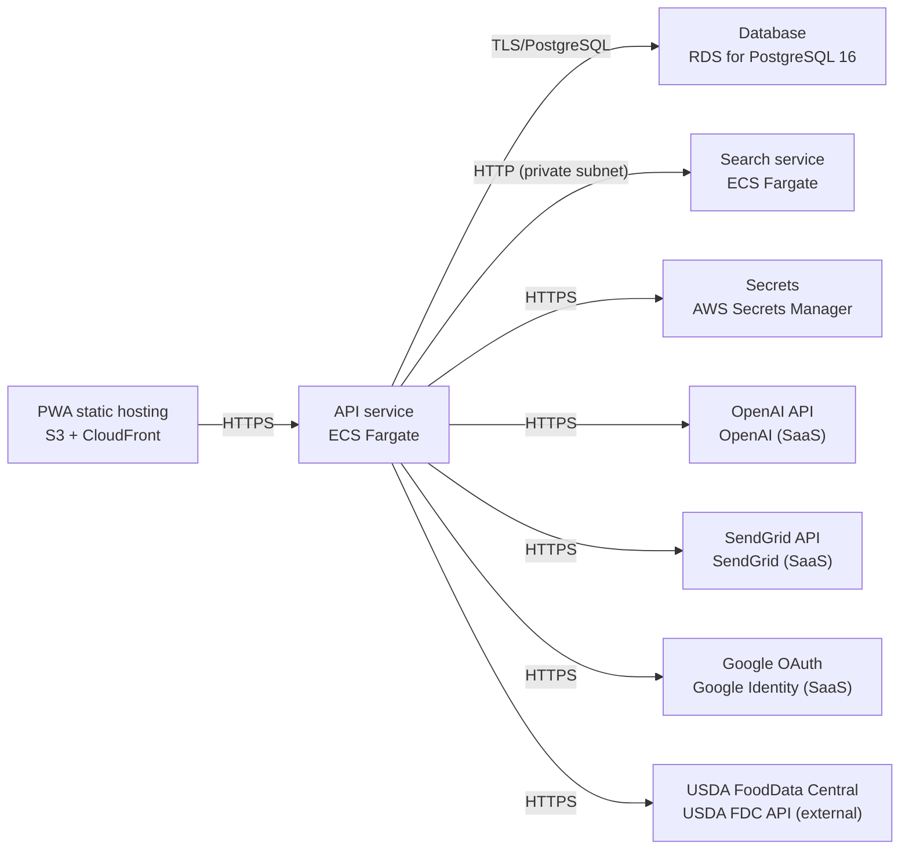

# Deployment Guide

> Maintained by QuorQ AI SDLC. Text between `sdlc:auto` markers is regenerated; anything outside them is yours and is kept.

<!-- sdlc:auto:start how-it-deploys -->
Pushes to `main` run `.github/workflows/deploy.yml`, which builds the API image (if there is a backend) and deploys the SPA to AWS Amplify. Commits touching only `docs/sdlc/**` don't deploy. Deployments can also be started from the platform's Deployment tab.
<!-- sdlc:auto:end how-it-deploys -->

<!-- sdlc:auto:start environments -->
| Name | Service | Runtime | Scaling | Environment |
|---|---|---|---|---|
| PWA static hosting | S3 + CloudFront | React 19 static build | CDN edge, static | dev |
| API service | ECS Fargate | FastAPI 0.115 on Uvicorn (Python 3.12) | 1-2 small tasks | dev |
| Database | RDS for PostgreSQL 16 | PostgreSQL 16 | Single managed instance with automated backups, EU region | dev |
| Search service | ECS Fargate | getmeili/meilisearch:v1.10.3 | 1 task with persistent EFS volume | dev |
| Secrets | AWS Secrets Manager | managed | n/a | dev |
| OpenAI API | OpenAI (SaaS) | external HTTPS | external | dev |
| SendGrid API | SendGrid (SaaS) | external HTTPS | external | dev |
| Google OAuth | Google Identity (SaaS) | external HTTPS | external | dev |
| USDA FoodData Central | USDA FDC API (external) | external HTTPS | external, used by seed job | dev |
<!-- sdlc:auto:end environments -->

<!-- sdlc:auto:start live -->
_Not deployed yet._
<!-- sdlc:auto:end live -->

<!-- sdlc:auto:start topology -->

<!-- sdlc:auto:end topology -->
